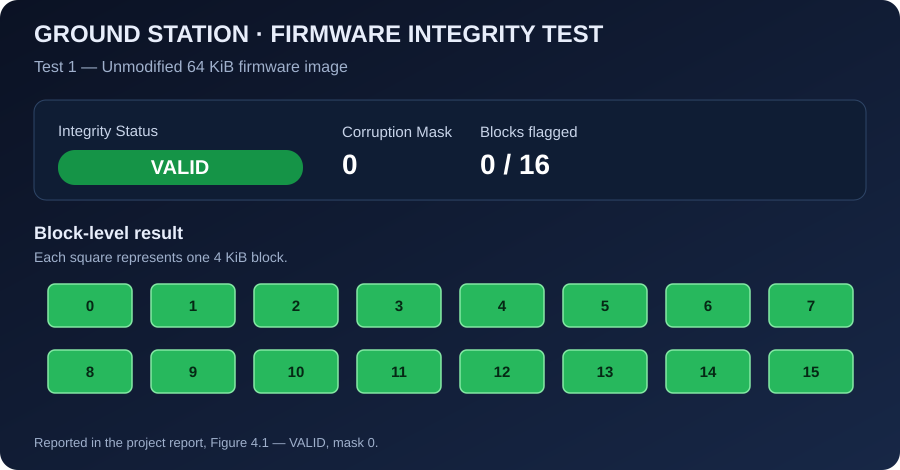
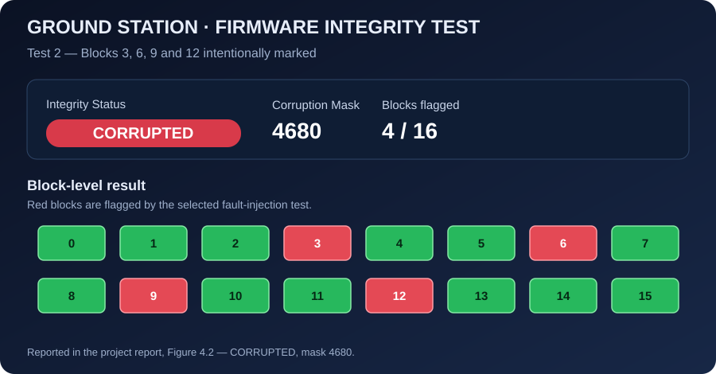

# Verification Test Results

The following figures reproduce the result states described in the submitted project report. They are **clean SVG illustrations reconstructed from the report's result screenshots**, not the original unmodified screenshots extracted from the PDF.

## Test 1 — Intact firmware image

The image is generated as 64 KiB of `0x01` bytes. With no blocks selected for fault injection, the report records an integrity result of **VALID** and a corruption mask of **0**.



*Figure 1. Intact firmware: all 16 blocks are green; no corruption bits are set. Source: project report, Figure 4.1, page 20.*

## Test 2 — Corrupted firmware image

Blocks 3, 6, 9 and 12 are marked by writing `0xFF` to the first byte of each selected 4 KiB block. The report records **CORRUPTED** with mask **4680**.



*Figure 2. Corrupted firmware: blocks 3, 6, 9 and 12 are red. Source: project report, Figure 4.2, page 21.*

## Additional case recorded in the report

The client-output example in Figure 3.2 (page 16) marks blocks 0, 5, 10 and 15. The reported mask is **33825**.

## Test summary

| Case | Selected blocks | Reported status | Reported mask |
|---|---|---|---:|
| Intact image | None | VALID | 0 |
| Corruption at selected blocks | 3, 6, 9, 12 | CORRUPTED | 4680 |
| Corruption at selected blocks | 0, 5, 10, 15 | CORRUPTED | 33825 |

These results are transcribed from the report and have not been independently rerun as part of this repository update.

## Manual verification procedure

1. Build the client and server with the QNX toolchain.
2. Copy both executables to the QNX target and start the server before launching the ground station.
3. Configure the ground-station connection using environment variables.
4. Run once without selecting any blocks.
5. Select blocks 3, 6, 9 and 12, then deploy again.
6. Confirm the integrity status, decimal mask and red/green result grid.
7. Capture any new target runs separately, so repository screenshots remain traceable to the test actually executed.

## Mask calculations

For blocks 3, 6, 9 and 12:

```text
(1 << 3) + (1 << 6) + (1 << 9) + (1 << 12) = 4680
```

For blocks 0, 5, 10 and 15:

```text
(1 << 0) + (1 << 5) + (1 << 10) + (1 << 15) = 33825
```

## Interpretation and limitation

The report's demo code creates its corruption mask by checking the first byte of each block against the expected `0x01` marker. Therefore, these tests demonstrate the report's injected-marker scenarios; they do not establish that the current mask locates arbitrary modifications anywhere within each 4 KiB block. A Merkle-root mismatch can indicate that the image is changed even if this marker-derived mask does not identify every modified block.
